# IceeBoot Backend

[简体中文](README.md) | **English**

IceeBoot is an application framework built with Java 21, Spring Boot 3.5, and Vue 3. The backend handles accounts, menus, API permissions, AgentScope agents, Activiti approval workflows, payments, and notifications. This guide takes you from signing in locally to adding a protected page and publishing an agent that can run scripts in a cloud sandbox.

[Set up the database](#database-setup) · [Start the service and sign in](#first-login) · [Add a menu with AI](#ai-menu) · [Connect an E2B sandbox](#e2b-setup) · [Publish and call an agent](#agent-release) · [Development and troubleshooting](#development)

The admin console screenshots show the standalone frontend demo in Chinese. The English captions describe the same forms you will see in the live console. To verify database writes, role permissions, or a cloud sandbox connection, point the frontend at your own backend. See the [frontend guide](https://github.com/perfectNB/IceeBoot-frontend-vue/blob/master/README.en.md).

<a id="database-setup"></a>

## 1. Set up MySQL and Redis

You need JDK 21, Maven, MySQL 8, and Redis 6.2 or later. These examples assume the backend and database run on your machine. Connect to MySQL with an account that can create databases and users. Choose a local password for the application account and run the following SQL.

```sql
CREATE DATABASE iceeboot_dev CHARACTER SET utf8mb4 COLLATE utf8mb4_unicode_ci;
CREATE USER 'iceeboot_app'@'localhost' IDENTIFIED BY 'replace-with-your-local-database-password';
GRANT ALL PRIVILEGES ON iceeboot_dev.* TO 'iceeboot_app'@'localhost';
```

From the root of the backend repository, connect with the new account. If `SHOW TABLES` returns no rows, import the snapshot of tables, menus, roles, and accounts. **Run `iceeboot.sql` only against a new, dedicated development database. It contains `DROP TABLE` statements and historical business data.** Use versioned migrations for existing deployments. For production, prepare a reviewed baseline with historical records removed.

```bash
mysql -h 127.0.0.1 -u iceeboot_app -p iceeboot_dev -e 'SHOW TABLES'
mysql -h 127.0.0.1 -u iceeboot_app -p iceeboot_dev < iceeboot.sql
mysql -h 127.0.0.1 -u iceeboot_app -p iceeboot_dev -e \
  'SELECT DATABASE(), COUNT(*) AS tables_after_import FROM information_schema.tables WHERE table_schema=DATABASE()'
```

Importing this snapshot on MySQL 8.0.46 produced **49 tables before the first application startup**. Startup migrations create additional tables.

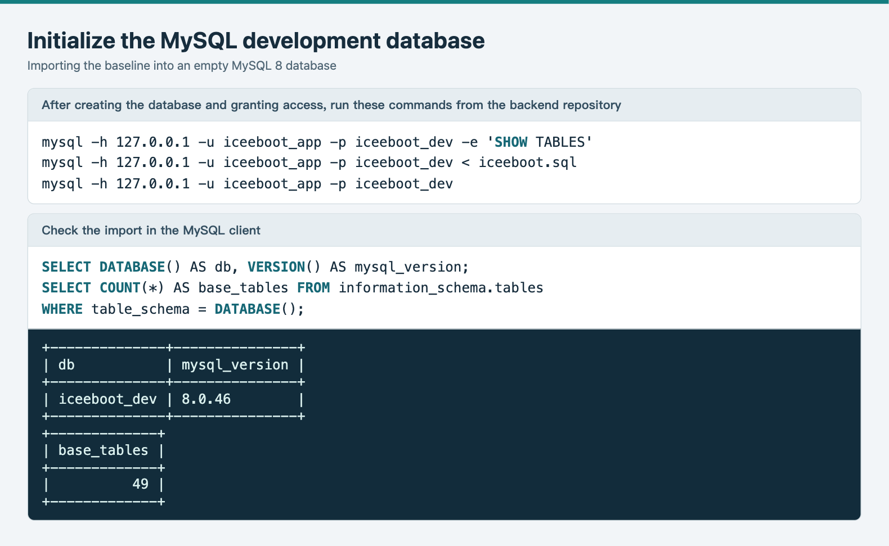

Test Redis from the environment that will run the Java process. For a local instance without a password, `redis-cli -h 127.0.0.1 -p 6379 PING` should return `PONG`. For an instance with a password or ACL, use `redis-cli --user <username> --askpass PING`. Inside a container, `127.0.0.1` refers to that container. For Docker Compose, use the Redis service name and container port.

<a id="first-login"></a>

## 2. Start the backend and sign in

`APP_PROFILE` selects the Spring profile. The default is `test`. See [application.yml](src/main/resources/application.yml) and the [test](src/main/resources/application-test.yml), [dev](src/main/resources/application-dev.yml), and [prod](src/main/resources/application-prod.yml) settings.

Set the following variables in the shell where you will start the application, or under **Environment variables** in your IntelliJ IDEA run configuration. Replace the password and key placeholders with your own values.

```bash
export APP_PROFILE=test
export DB_URL='jdbc:mysql://127.0.0.1:3306/iceeboot_dev?allowPublicKeyRetrieval=true&useSSL=false&characterEncoding=UTF-8&serverTimezone=Asia/Shanghai'
export DB_USERNAME='iceeboot_app'
export DB_PASSWORD='<password-you-set-for-iceeboot_app>'
export REDIS_HOST='127.0.0.1'
export REDIS_PORT='6379'
export REDIS_USERNAME='default'
export REDIS_PASSWORD=''
export REDIS_DATABASE='0'
export JWT_SECRET_KEY='<independently-generated-signing-key>'
export AI_CONFIG_ENCRYPTION_KEY_ID='local-v1'
export AI_CONFIG_ENCRYPTION_KEY='<32-random-bytes-encoded-as-base64>'
export YUN_GOU_OS_MCH_ID='local-demo'
export YUN_GOU_OS_KEY='local-demo'
```

- Run `openssl rand -base64 32` twice to generate separate signing and encryption keys. Store each value and reuse it across restarts. The backend encrypts model API keys, tool request headers, and agent sandbox environment variables. You need the decryption key to read previously saved configuration. See the [key rotation guide](docs/agent-maintenance-20261111.md).
- Set `REDIS_USERNAME` and `REDIS_PASSWORD` to match your Redis instance. The example uses the default account on a local instance without a password. The JDBC options that disable TLS are for local development.
- The `test` and `prod` profiles inject `YUN_GOU_OS_MCH_ID` and `YUN_GOU_OS_KEY` into the login and payment services at startup. The example values support local startup and password login. Supply the merchant credentials from your deployment environment when integrating the corresponding WeChat or payment channels.

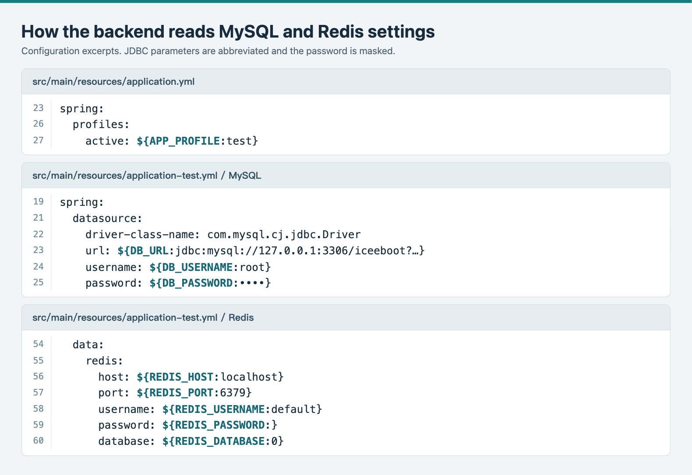

```bash
java -version
mvn -version
mvn spring-boot:run
```

On first startup, the backend applies registered migrations, creates missing entity tables, and populates role-based access control records. Run the following query against your development database to see which migrations completed. The service verifies checksums for applied scripts, so give each subsequent migration a new version.

```sql
SELECT version, description, installed_at
FROM t_agent_schema_history ORDER BY version DESC LIMIT 5;
```

**Sign in.** In the frontend repository, run `npm ci` followed by `npm run dev`. Open the [local homepage](http://localhost:4396) and sign in with an active administrator account from your development database. Set `VITE_APP_BASE_API=http://localhost:9000/iceeboot` in the frontend. The full API root is `http://localhost:9000/iceeboot/api`. For password login, the backend checks login limits in Redis, verifies the account in MySQL, and issues an access token.

<details>
<summary>Setting the administrator password for a fresh local development database</summary>

The snapshot includes an `admin` account. The deployment owner controls its password. The standalone frontend demo has its own credentials. For a newly created personal development database, set an initial password before opening the service. The backend uses BCrypt. If you have Apache's `htpasswd` utility, run `htpasswd -nBC 12 admin` and enter your chosen password when prompted. Copy the entire hash after `admin:` in the output.

Confirm the account and replace the placeholder with that hash in the fresh database.

```sql
USE iceeboot_dev;
SELECT id, username, status FROM t_user WHERE username='admin' AND del_flag=0;
UPDATE t_user SET password='<full-BCrypt-hash>'
WHERE username='admin' AND del_flag=0 AND status='active';
```

Confirm one row was updated. Sign in with `admin` and the password you entered. In an existing shared deployment, ask the administrator to provision an account. Management endpoints for agent features such as sandboxes and model connections also require the `superAdmin` role.

</details>

<a id="ai-menu"></a>

## 3. Add a protected menu with an AI coding assistant

The following example adds an **Inspection Records** page under **System Management**. Open both repositories in the same coding workspace and give the assistant this prompt. A page, list endpoint, and versioned migration allow the same feature to be deployed to another environment.

```text
Read AGENTS.md in both repositories and inspect an existing System Management page.
Add System Management → Inspection Records. Use /admin/system/inspection-records for
the route path and InspectionRecords for both the route and Vue component name.

Implement the frontend page, its list request, and GET /v1/inspections on the backend,
with a paginated response. Use system:inspection:view for viewing the page and
system:inspection:list:api for the list endpoint.

Follow the existing backend package structure. Annotate the controller with
@RequirePermission(dynamic = true). Use a query object for pagination and return the
project's R response wrapper with a VO.

Add and register an idempotent versioned migration for the menu, permissions, and
role associations. Grant the feature to superAdmin by default. If a regular role
needs it, list the role codes and ask me which one to grant.

Build frontend routes from the menus returned by the API. Use the existing src/api
request wrapper. Update the permission catalog and relevant tests. List the changed
files, migration SQL, and acceptance checks for an administrator and an unauthorized
account. Verify using a development database only.
```

Use the three console screens below to review the result. The screenshots use the built-in User Management page and its list permission as a reference. To grant a role access to an existing page, you can make the assignments in the console.

1. **System Management → Menu Management.** In `t_menu`, check the parent, the unique route name `InspectionRecords`, the display title, path, component, enabled status, and view permission. The frontend searches `src/pages/**/*.vue` by component name. Set `component` to the matching page name without the `.vue` suffix.

   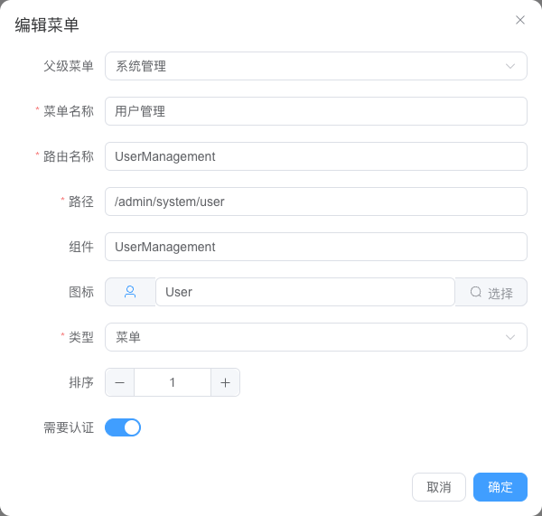

2. **System Management → Permission Management.** Menu and button permissions control which actions appear in the frontend. Register the list API in `t_permission` with `type=api`, `method=GET`, `path=/v1/inspections`, and `code=system:inspection:list:api`. Omit the host, the application context `/iceeboot/api`, and query parameters from this path. Give write operations separate permissions so a role with list access can only read the records.

   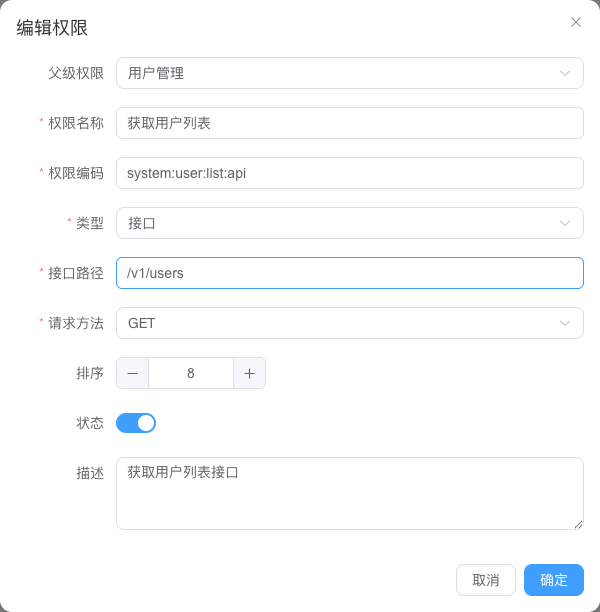

3. **System Management → Role Management.** Assign menus through `t_role_menu` and permissions through `t_role_permission`. A regular role needs the target menu, its parent navigation entry, and the permissions required by both the page and its API. In migrations, look up roles by code so the same script works with different numeric IDs.

   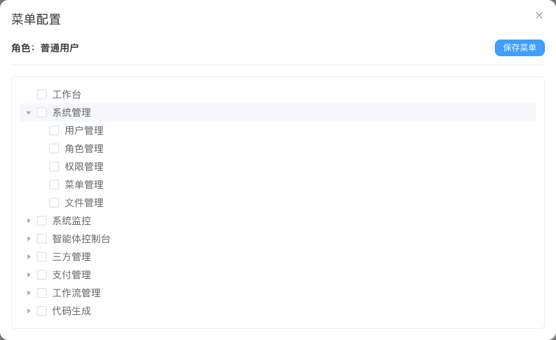

   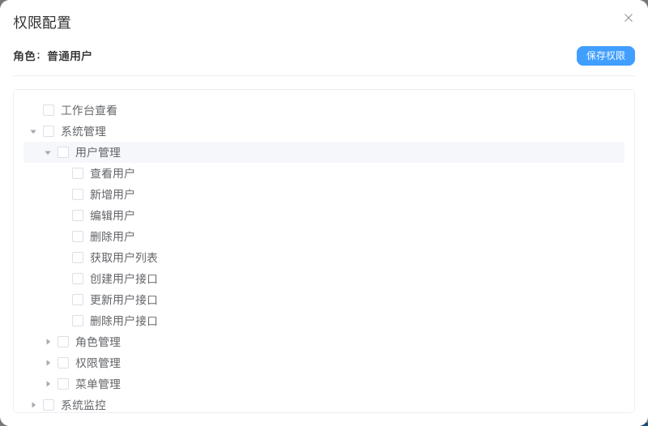

**Verify access.** Check that the new script appears in [db/agent](src/main/resources/db/agent) and in the list maintained by the [migration service](src/main/java/com/iceeboot/framework/service/database/AgentSchemaMigrationService.java). Add the protected endpoint to the [API permission catalog](src/test/resources/rbac/permission-catalog.json). Start the backend against the development database and check the migration history. Sign in again as an administrator, open the page through its menu, and load the list. Then call the endpoint directly with an unauthorized account and verify that the response denies access. This checks the server-side authorization as well as what the UI displays. See the [framework permission conventions](docs/framework-permissions-20261111.md).

<a id="e2b-setup"></a>

## 4. Connect E2B and register a sandbox template

Basic conversations and HTTP tools can run without a sandbox. For shell commands, Python, or scripts packaged in skills, prepare a cloud template, configure the backend connection, register the template in IceeBoot, and bind it to an agent.

**Prepare a template on Alibaba Cloud.** Use an existing E2B-compatible template or build a custom one with the required runtime and dependencies. Once it is ready, copy the template ID or name accepted by the cloud service. Get the API endpoint and sandbox domain for the same region. See the [Alibaba Cloud E2B SDK connection parameters](https://help.aliyun.com/zh/functioncompute/e2b-sdk-integration-parameter-description) and [custom image template guide](https://help.aliyun.com/zh/functioncompute/build-a-custom-image-template).

**Configure the Java process.** Add these variables to its environment.

```bash
export ALIYUN_E2B_API_KEY='<sandbox-api-key-for-your-region>'
export ALIYUN_E2B_API_BASE_URL='<cloud-api-endpoint-including-https://>'
export ALIYUN_E2B_DOMAIN='<sandbox-domain-without-scheme-or-path>'
```

Alibaba Cloud calls the API endpoint `E2B_API_URL`. IceeBoot reads it from `ALIYUN_E2B_API_BASE_URL`. The backend binds all three settings under `iceeboot.agent.e2b`. **Restart the backend** after changing them.

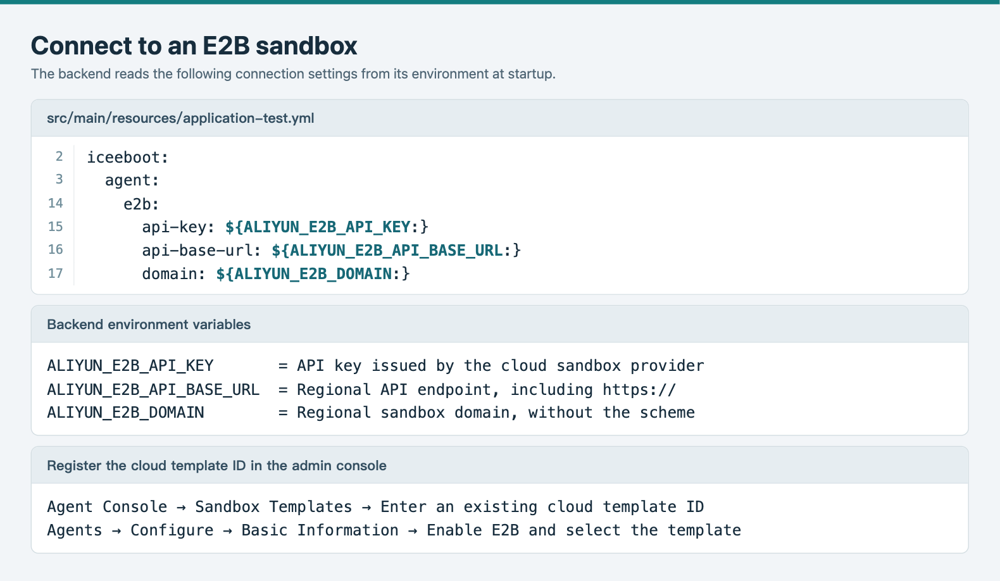

**Register the cloud template in the console.** Sign in as a super administrator. Under **Agent Console → Sandbox Templates**, choose the action to create a template. IceeBoot saves the configuration that agents can select. The cloud provider builds and publishes the image.

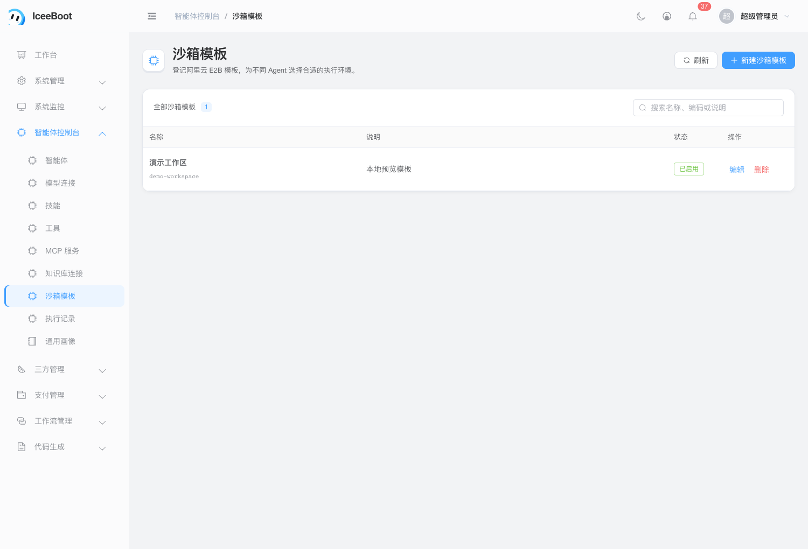

| Field | Value |
| --- | --- |
| Name / unique code | For example, `Python analytics` and `python_workspace`. IceeBoot uses these to identify the local configuration. |
| Alibaba Cloud E2B template ID / name | Enter the **cloud template ID or name** from the previous step. This identifies the runtime image in your provider account. |
| Sandbox lifetime | Set a duration from 60 to 3600 seconds. The form defaults to 600 seconds. |
| Enabled | Enable the template and save it to make it available in the agent settings. |

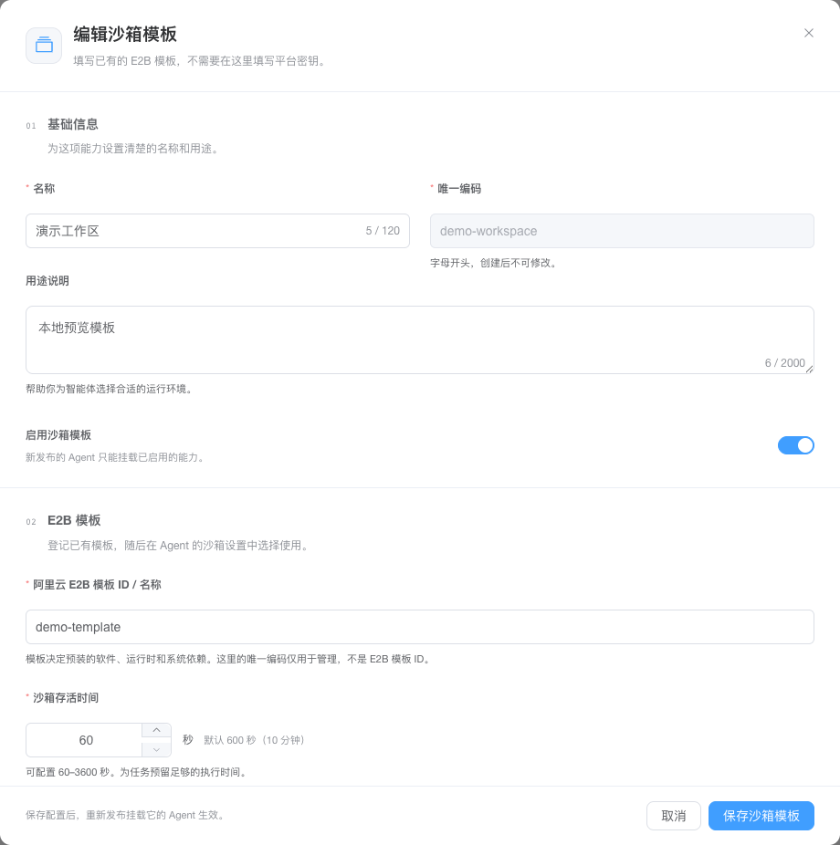

<a id="agent-release"></a>

## 5. Bind a sandbox, publish the agent, and call it

1. Under **Agent Console → Model Connections**, create and enable a connection. Enter the provider, supported protocol, model identifier, provider base URL, and API key. The backend uses the encryption key from step 2 to store sensitive settings.

   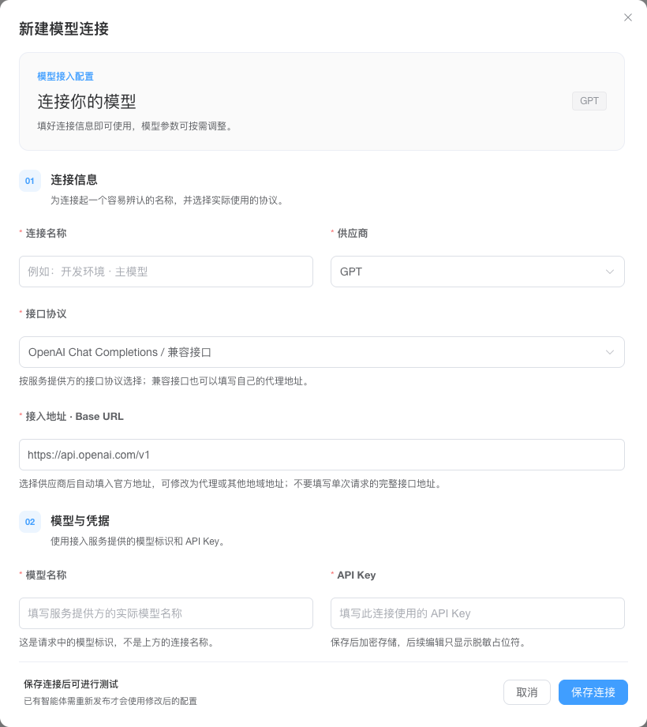

2. Open **Agents** and create or configure an agent. Enter its name, unique code, and prompt, then select the model connection. This example uses the code `assistant`. For scripts, open **Basic Information**, enable **E2B Sandbox**, and select the template you registered. Attach any required skills or tools. Set any variables your scripts need under the agent's **Environment Variables** section.

   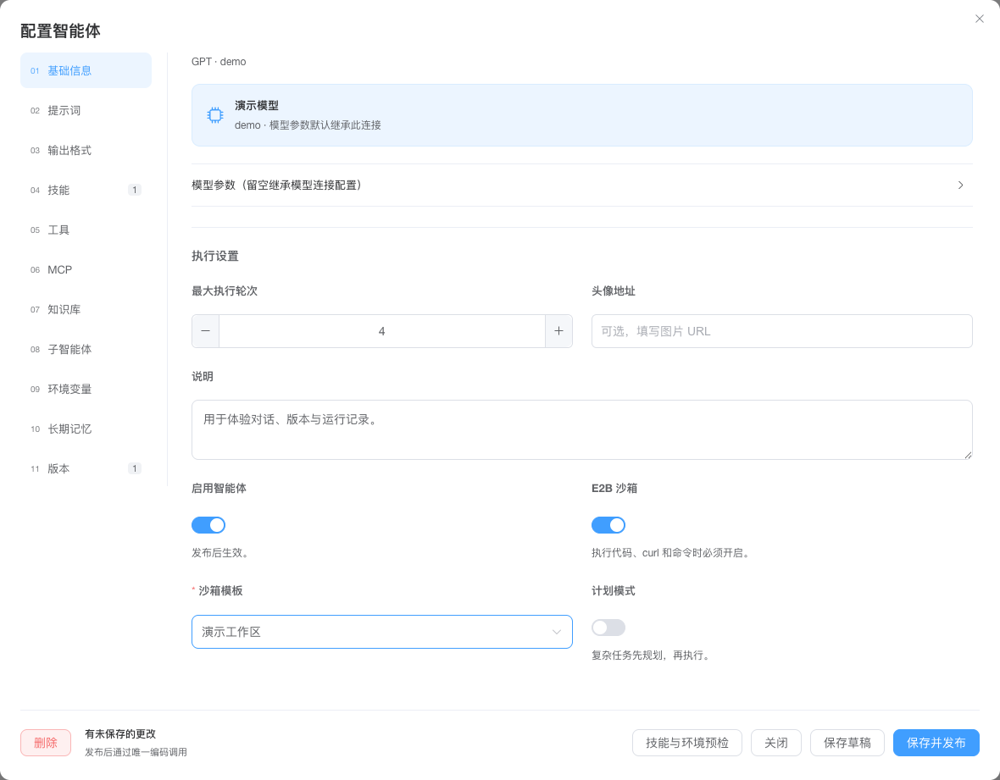

3. Select **Save Draft** and then **Skill and Environment Preflight**. The preflight reads the latest saved draft. With a live backend and sandbox enabled, it creates and releases a cloud sandbox to check the working directory and recognized dependencies. Provider charges may apply. If a dependency is missing, update the cloud template, register or bind the updated template, and repeat the check. Verify your business scripts and model calls in an actual run.

   The demo screenshot shows a successful model connection check. Use the live preflight report to verify sandbox startup, the working directory, and dependencies.

   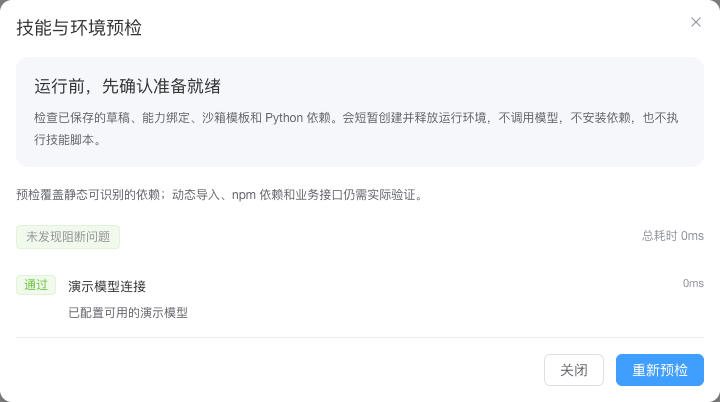

4. Select **Save and Publish**. A release captures the model and resource configuration at publication time. After changing a template or model, republish each agent that uses it. Open **Start Chat**, send a simple request, and use **Execution Records** to check its result and run ID.

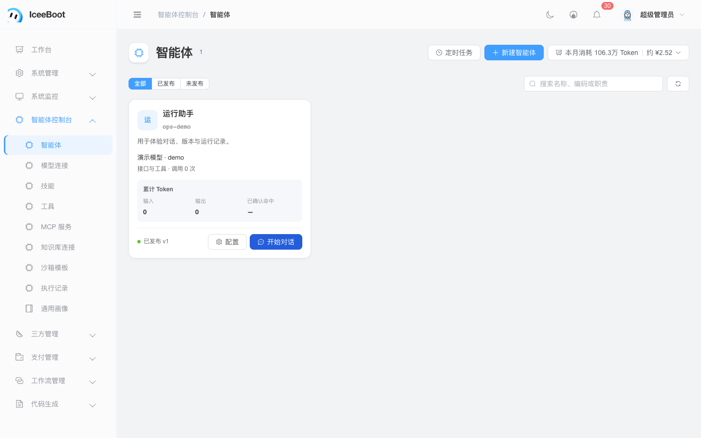

To call an agent from a business application, supply an access token for an authorized `superAdmin` account via the calling process's `ACCESS_TOKEN` environment variable. Replace `assistant` in the URL with the **published agent's code**.

```bash
curl -sS -X POST 'http://localhost:9000/iceeboot/api/v1/agent-console/agents/by-code/assistant/invoke' \
  -H "Authorization: Bearer ${ACCESS_TOKEN}" \
  -H 'Content-Type: application/json' \
  -d '{"input":"Describe your role in one sentence."}'
```

On success, the JSON response contains `code: 200`, the answer in `result.output`, and the execution record ID in `result.runId`. To test script execution, send a task that requires an attached script, then inspect the tool steps for that run. See [sessions and attachments](docs/agent-workbench.md), [streaming](docs/agent-streaming.md), [scheduled runs](docs/agent-schedules.md), and [long-term memory](docs/agent-memory.md).

<a id="development"></a>

## Development and troubleshooting

| Task | Where to start |
| --- | --- |
| Extend APIs, persistence, or transactions | [Controllers](src/main/java/com/iceeboot/framework/controller), [services](src/main/java/com/iceeboot/framework/service), [data objects](src/main/java/com/iceeboot/framework/entity), and [mappers](src/main/java/com/iceeboot/framework/mapper). Use DTOs or query objects for inputs and VOs for outputs. See the [development conventions](AGENTS.md). |
| Work with models, skills, tools, MCP, knowledge bases, or sandboxes | [Agent services](src/main/java/com/iceeboot/framework/service/agent), [agent configuration](src/main/java/com/iceeboot/config/agent), and [skill import guide](docs/skill-import.md). |
| Extend workflows and approvals | [Workflow services](src/main/java/com/iceeboot/framework/service/workflow) handle designs, releases, eligible applicant roles, amount-based routing, countersignatures, and approval history. |
| Integrate payments or generate code | [Payment channels](docs/payment-channels.md) and [code generator](src/main/java/com/iceeboot/generator). |
| Run tests or build the JAR | From the repository root, run `sh scripts/verify.sh` for convention checks and Maven `clean verify`. Run the artifact in the same environment with `java -jar target/iceeboot-backend-java-1.0.0.jar`. |

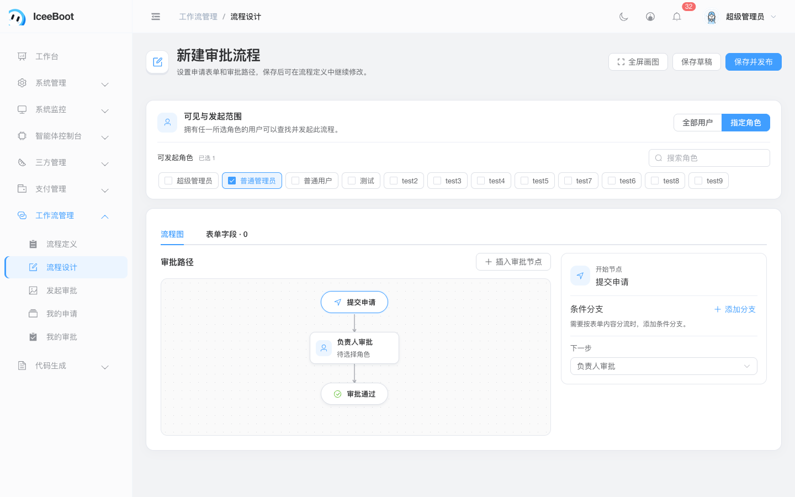

| Symptom | What to check |
| --- | --- |
| Database connection or migration error at startup | Connect to the target database as the application user from the backend environment. Check the profile, database name, grants, migration version, and logs. Back up the database and encryption keys before upgrading an existing deployment. |
| The page loads, but sign-in reports a Redis connection failure | Test `PING` using the backend's Redis host, port, username, and password. Check any container port mappings and where the backend runs. |
| The menu appears but the page cannot open, or a list or button returns access denied | Check the component name, the menus assigned to the current role, the button permission, and the HTTP method and path of the API permission. Some endpoints also check resource ownership or require the `superAdmin` role. |
| The template was saved, but preflight fails | Check that the backend process has all three E2B variables, the template is ready in the same region, and the runtime dependencies are installed. Look for the failing item in the preflight report. |
| You need to check endpoint parameters | Open [local Swagger UI](http://localhost:9000/iceeboot/api/swagger-ui/index.html) or the [OpenAPI JSON](http://localhost:9000/iceeboot/api/v3/api-docs). For an API definition error, use the response's `traceId` to find the matching log entry, then check the controller path and request DTO. |

[License](LICENSE)
