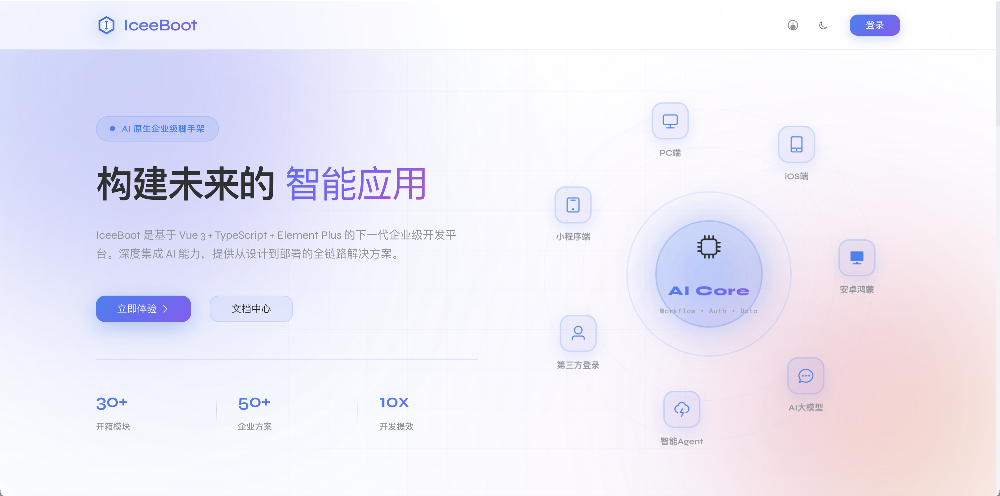
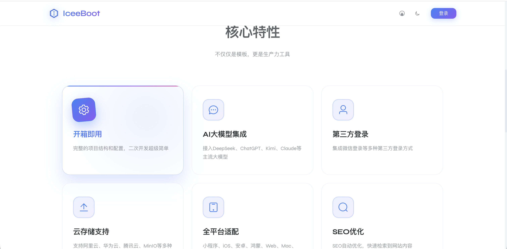
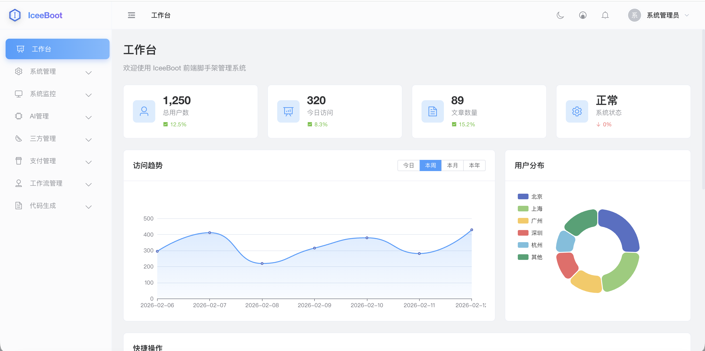
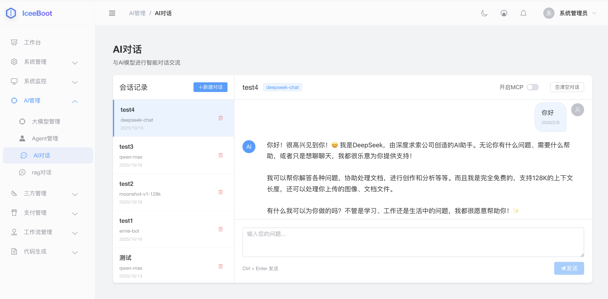
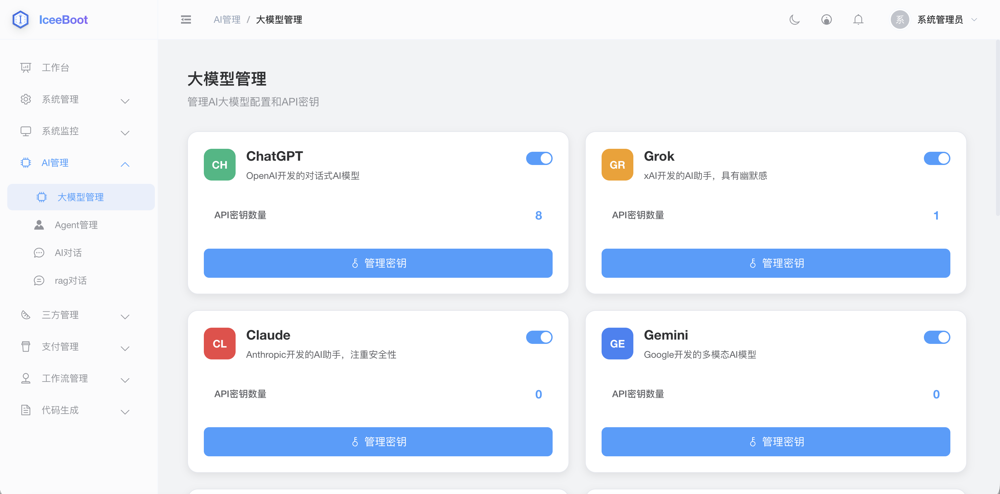
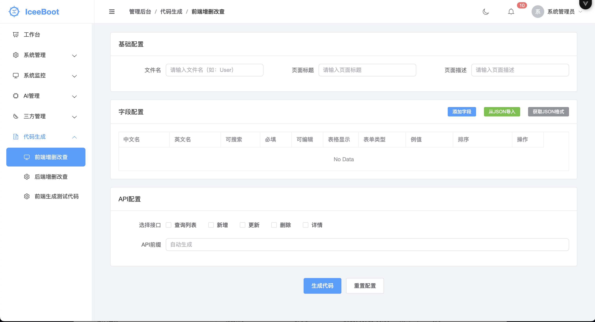
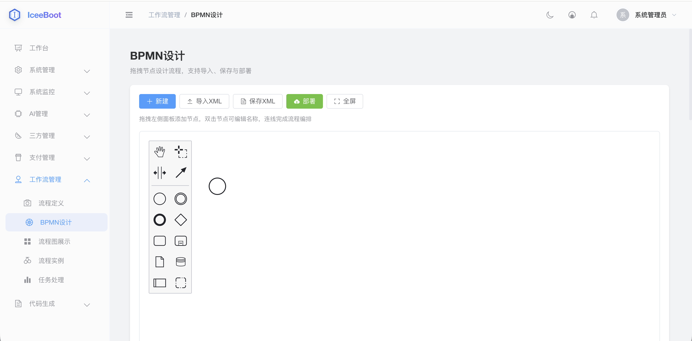
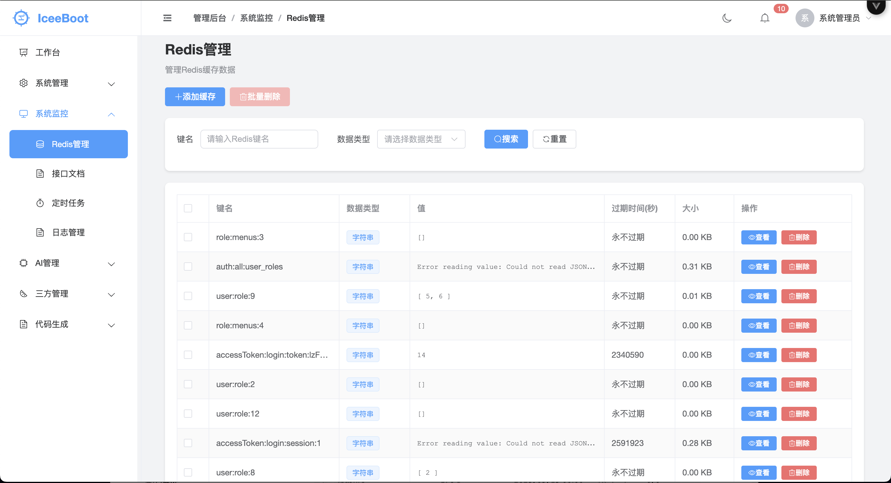
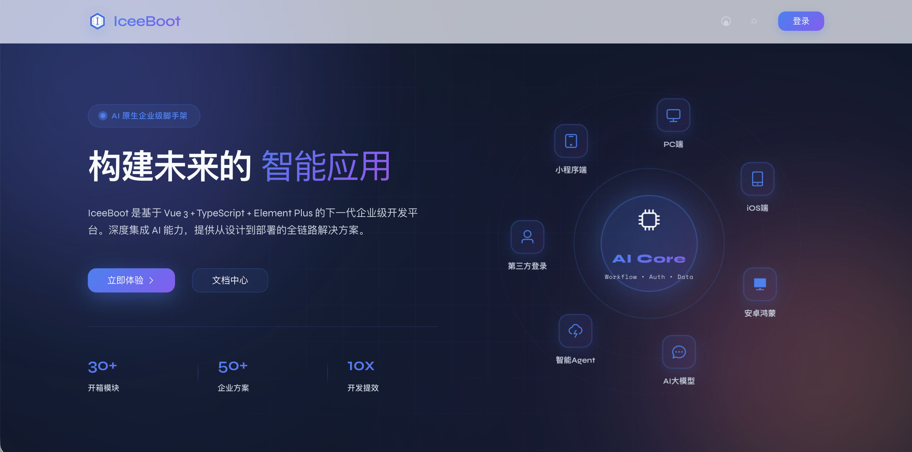

# IceeBoot 超级脚手架

<div align="center">


**🚀 现代化 SaaS 应用后端脚手架 | 开箱即用的多厂商集成方案**

[](https://spring.io/projects/spring-boot)
[](https://www.oracle.com/java/technologies/javase/jdk21-archive-downloads.html)
[](https://www.apache.org/licenses/LICENSE-2.0)
[](https://qm.qq.com/q/xxx)

</div>

---

## 📖 项目简介

IceeBoot 是一个基于 **Spring Boot 3.5.5 + Java 21** 的现代化企业级后端脚手架，专为 SaaS 应用和需要集成多个第三方服务的项目设计。

与传统后台管理脚手架不同，IceeBoot 的核心优势在于：
- ✨ **开箱即用的多厂商集成**：LLM（AI大模型）、OSS（对象存储）、SMS（短信）、Email（邮件）
- 🏗️ **优雅的架构设计**：策略模式 + Spring 自动注入，厂商切换无需改代码
- 🔒 **企业级安全防护**：XSS 过滤、登录限流、账号锁定、API 密钥脱敏、安全响应头
- 🎯 **智能代码生成器**：一键生成 Controller/Service/Mapper/DTO/VO 全套代码
- 🌙 **现代化技术栈**：Spring Boot 3、Java 21、MyBatis-Plus、Sa-Token、Redis

---

## ✨ 核心特性

### 🎨 功能特性

- **完整的 RBAC 权限体系**：角色、菜单、权限动态管理，支持注解式权限控制
- **多厂商服务集成**：
  - 🤖 **AI 大模型**：OpenAI、通义千问、文心一言、讯飞星火、DeepSeek、Kimi、智谱 GLM
  - 📦 **对象存储**：阿里云 OSS、腾讯云 COS、华为云 OBS、MinIO、七牛云
  - 📱 **短信服务**：阿里云、腾讯云、华为云、网易云信、容联云、七牛云
  - 📧 **邮件服务**：QQ 邮箱、Gmail、网易邮箱、Outlook、腾讯企业邮箱、阿里企业邮箱
- **工作流引擎**：集成 Activiti 7，支持流程设计、审批、监控
- **代码生成器**：智能生成 CRUD 代码，支持删除回滚
- **微信扫码登录**：支持微信 OAuth 授权登录
- **系统监控**：服务器监控、Redis 监控、接口性能监控

### 🔒 安全特性

- **认证授权**：Sa-Token + Redis，支持分布式部署
- **防暴力破解**：IP 限流 + 账号锁定（5 次失败锁定 30 分钟）
- **XSS 防护**：全局 XSS 过滤器，自动转义危险字符
- **SQL 注入防护**：MyBatis-Plus 全参数化查询
- **文件上传安全**：白名单 + 黑名单双重校验，拦截危险文件
- **数据脱敏**：API 密钥自动脱敏，日志敏感信息过滤
- **安全响应头**：X-Frame-Options、X-Content-Type-Options、CSP 等
- **密码加密**：BCrypt 强哈希（cost factor 12）

### 🏗️ 架构特性

- **分层清晰**：Controller → Service → Mapper，DTO/VO/Entity 严格分离
- **策略模式**：工厂 + 策略模式实现多厂商无缝切换
- **事务管理**：@Transactional + TransactionTemplate 双重保障
- **缓存体系**：Redis 缓存 + 统一 Key 管理
- **异常处理**：全局异常捕获，统一响应格式
- **日志规范**：Slf4j + 敏感信息脱敏

---

## 🖼️ 界面展示

### 首页概览



### 主页仪表盘



### AI 大模型集成





### 代码生成器



### 工作流引擎



### 系统监控



### 黑夜模式



---

## 🛠️ 技术栈

### 后端技术

| 技术 | 版本 | 说明 |
|------|------|------|
| Spring Boot | 3.5.5 | 核心框架 |
| Java | 21 | 开发语言 |
| MyBatis-Plus | 3.5.9 | ORM 框架 |
| Sa-Token | 1.39.0 | 认证授权 |
| Redis | - | 缓存 + 分布式锁 |
| MySQL | 8.0+ | 数据库 |
| Knife4j | 4.5.0 | API 文档 |
| Hutool | 5.8.22 | 工具类库 |
| Activiti | 7.1.0.M6 | 工作流引擎 |
| Beetl | 3.15.10 | 模板引擎 |

### 第三方 SDK

- **AI 大模型**：OpenAI SDK、阿里云 DashScope、讯飞星火 SDK
- **对象存储**：阿里云 OSS、腾讯云 COS、华为云 OBS、MinIO、七牛云 SDK
- **短信服务**：阿里云、腾讯云、华为云、网易云信、容联云、七牛云 SDK
- **邮件服务**：Jakarta Mail

---

## 🚀 快速开始

### 环境要求

- JDK 21+
- Maven 3.8+
- MySQL 8.0+
- Redis 5.0+

### 1. 克隆项目

```bash
git clone https://github.com/your-repo/iceeboot.git
cd iceeboot/zboot-backend-java
```

### 2. 创建数据库

```sql
CREATE DATABASE iceeboot DEFAULT CHARACTER SET utf8mb4 COLLATE utf8mb4_unicode_ci;
```

导入初始化脚本（如果有的话）：
```bash
mysql -u root -p iceeboot < docs/sql/iceeboot.sql
```

### 3. 配置环境变量

**重要：IceeBoot 不使用硬编码密码，所有敏感配置通过环境变量注入。**

创建环境变量配置文件（推荐使用 `.env` 或系统环境变量）：

```bash
# 数据库配置
export DB_URL="jdbc:mysql://localhost:3306/iceeboot?useUnicode=true&characterEncoding=utf8&serverTimezone=GMT%2B8"
export DB_USERNAME="root"
export DB_PASSWORD="your_mysql_password"

# Redis 配置
export REDIS_HOST="localhost"
export REDIS_PORT="6379"
export REDIS_PASSWORD="your_redis_password"
export REDIS_DATABASE="0"

# JWT 密钥（必须设置，建议使用随机生成的 256 位密钥）
export JWT_SECRET_KEY="$(openssl rand -base64 32)"

# 微信登录配置（可选）
export YUN_GOU_OS_MCH_ID="your_mch_id"
export YUN_GOU_OS_KEY="your_key"

# Elasticsearch 配置（可选）
export ES_USERNAME=""
export ES_PASSWORD=""
```

### 4. 启动项目

```bash
# 编译
mvn clean compile

# 运行
mvn spring-boot:run

# 或者打包后运行
mvn clean package -DskipTests
java -jar target/iceeboot-backend-java-1.0.0.jar
```

### 5. 访问项目

- **后端 API**：http://localhost:9000/iceeboot/api
- **API 文档**：http://localhost:9000/iceeboot/api/doc.html
- **健康检查**：http://localhost:9000/iceeboot/api/health

---

## 📁 项目结构

```
zboot-backend-java/
├── src/main/java/com/iceeboot/
│   ├── common/                    # 公共模块
│   │   ├── annotation/           # 自定义注解（@RateLimit、@Sensitive、@RequirePermission）
│   │   ├── aspect/               # AOP 切面（限流、权限）
│   │   ├── constant/             # 常量类（SystemConstants、CacheConstants、ResponseMessage）
│   │   ├── core/                 # 核心类（统一响应、分页）
│   │   ├── enums/                # 枚举类
│   │   ├── exception/            # 异常类 + 全局异常处理器
│   │   ├── service/              # 公共服务（LLM、OSS、SMS、Email）
│   │   │   ├── ai/llm/          # AI 大模型服务（策略模式）
│   │   │   ├── oss/             # 对象存储服务（策略模式）
│   │   │   ├── sms/             # 短信服务（策略模式）
│   │   │   └── email/           # 邮件服务（策略模式）
│   │   └── utils/                # 工具类（Redis、密码、脱敏）
│   ├── config/                    # 配置类
│   │   ├── security/             # 安全配置（Sa-Token、XSS、CORS、安全响应头）
│   │   └── interceptor/          # 拦截器（权限拦截器）
│   ├── framework/                 # 业务框架
│   │   ├── controller/           # 控制器
│   │   ├── service/              # 服务接口
│   │   ├── mapper/               # Mapper 接口
│   │   ├── entity/               # 实体类（DO）
│   │   ├── dto/                  # 数据传输对象（DTO）
│   │   ├── vo/                   # 视图对象（VO）
│   │   └── query/                # 查询对象（Query）
│   ├── generator/                 # 代码生成器
│   │   ├── CodeGenerator.java   # 代码生成器主类
│   │   └── CodeGeneratorTest.java
│   └── IceeBootApplication.java  # 启动类
├── src/main/resources/
│   ├── application.yml           # 主配置文件
│   ├── application-test.yml      # 测试环境配置
│   ├── application-prod.yml      # 生产环境配置
│   ├── mapper/                   # MyBatis XML 映射文件
│   ├── templates/                # Beetl 代码生成模板
│   └── assets/                   # 静态资源（图片）
└── pom.xml                        # Maven 配置
```

---

## 🎯 代码生成器使用

IceeBoot 内置智能代码生成器，可一键生成完整的 CRUD 代码。

### 生成代码

```java
public class CodeGeneratorTest {
    public static void main(String[] args) {
        CodeGenerator generator = new CodeGenerator();

        // 生成用户模块代码
        // 参数1：包名（如 user、order、product）
        // 参数2：实体名（如 User、Order、Product）
        generator.generateCode("user", "User");
    }
}
```

生成的文件包括：
- `UserController.java` - 控制器（增删改查接口）
- `IUserService.java` - 服务接口
- `UserServiceImpl.java` - 服务实现
- `UserMapper.java` - Mapper 接口
- `UserMapper.xml` - MyBatis XML
- `UserDO.java` - 实体类
- `UserDTO.java` - 创建 DTO
- `UserUpdateDTO.java` - 更新 DTO
- `UserVO.java` - 视图对象
- `UserQuery.java` - 查询对象

### 删除代码

代码生成器支持智能删除，会检测实体类字段数量并给出警告：

```java
generator.deleteCode("user", "User");
```

- 如果实体类没有业务字段，直接删除
- 如果有业务字段，会警告并询问是否删除
- 删除后可以选择恢复

---

## 🔧 配置说明

### 核心配置

#### 1. Sa-Token 配置

```yaml
sa-token:
  token-name: accessToken
  timeout: 7200                    # token 有效期 2 小时
  is-concurrent: false             # 禁止并发登录（新登录踢掉旧登录）
  is-share: true                   # 同一账号共用 token
  token-style: random-128          # token 风格
  jwt-secret-key: ${JWT_SECRET_KEY}  # JWT 密钥（必须通过环境变量设置）
```

#### 2. 认证配置

```yaml
iceeboot:
  auth:
    refresh-token-expire-seconds: 604800  # refresh token 有效期 7 天
    exclude-paths:                        # 不需要认证的路径
      - /v1/auth/login
      - /v1/auth/refresh
      - /doc.html
      - /swagger-ui/**
```

#### 3. CORS 配置

```yaml
iceeboot:
  cors:
    allowed-origins: http://localhost:5173,http://127.0.0.1:5173
    allowed-headers: "*"
    allowed-methods: GET,POST,PUT,DELETE,OPTIONS,PATCH
    allow-credentials: true
    max-age: 3600
```

### 多厂商服务配置

#### LLM（AI 大模型）配置

在数据库 `t_ai_llm_key` 表中配置各厂商的 API 密钥：

| 厂商 | provider | 必填字段 |
|------|----------|----------|
| OpenAI | openai | apiKey |
| 通义千问 | qwen | apiKey |
| 文心一言 | ernie | apiKey, secretKey |
| 讯飞星火 | spark | apiKey, secretKey, appId |
| DeepSeek | deepseek | apiKey |
| Kimi | kimi | apiKey |
| 智谱 GLM | glm | apiKey |

#### OSS（对象存储）配置

在数据库 `t_oss_key` 表中配置：

| 厂商 | provider | 必填字段 |
|------|----------|----------|
| 阿里云 OSS | aliyun | accessKeyId, accessKeySecret, endpoint |
| 腾讯云 COS | tencent | accessKeyId, accessKeySecret, region |
| 华为云 OBS | huawei | accessKeyId, accessKeySecret, endpoint |
| MinIO | minio | accessKeyId, accessKeySecret, endpoint |
| 七牛云 | qiniu | accessKeyId, accessKeySecret, region |

#### SMS（短信）配置

在数据库 `t_sms_key` 表中配置：

| 厂商 | provider | 必填字段 |
|------|----------|----------|
| 阿里云 | aliyun | accessKeyId, accessKeySecret |
| 腾讯云 | tencent | accessKeyId, accessKeySecret |
| 华为云 | huawei | accessKeyId, accessKeySecret, endpoint |
| 网易云信 | netease | accessKeyId, accessKeySecret |
| 容联云 | ronglian | accessKeyId, accessKeySecret |
| 七牛云 | qiniu | accessKeyId, accessKeySecret |

#### Email（邮件）配置

在数据库 `t_email_key` 表中配置：

| 厂商 | provider | 必填字段 |
|------|----------|----------|
| QQ 邮箱 | qq | emailAddress, emailPassword, smtpHost, smtpPort |
| Gmail | gmail | emailAddress, emailPassword, smtpHost, smtpPort |
| 网易邮箱 | netease | emailAddress, emailPassword, smtpHost, smtpPort |
| Outlook | outlook | emailAddress, emailPassword, smtpHost, smtpPort |
| 腾讯企业邮箱 | tencent | emailAddress, emailPassword, smtpHost, smtpPort |
| 阿里企业邮箱 | aliyun | emailAddress, emailPassword, smtpHost, smtpPort |

---

## 🔐 安全最佳实践

### 1. 环境变量配置

**永远不要在代码或配置文件中硬编码密码！**

生产环境建议使用：
- Docker Secrets
- Kubernetes Secrets
- 云服务商的密钥管理服务（如阿里云 KMS、AWS Secrets Manager）

### 2. JWT 密钥生成

```bash
# 生成 256 位随机密钥
openssl rand -base64 32
```

### 3. 数据库密码

使用强密码，至少包含：
- 大小写字母
- 数字
- 特殊字符
- 长度 ≥ 16 位

### 4. Redis 密码

```bash
# 在 redis.conf 中设置
requirepass your_strong_redis_password
```

### 5. HTTPS 部署

生产环境必须使用 HTTPS，Nginx 配置示例：

```nginx
server {
    listen 443 ssl http2;
    server_name api.yourdomain.com;

    ssl_certificate /path/to/cert.pem;
    ssl_certificate_key /path/to/key.pem;

    # 安全响应头
    add_header Strict-Transport-Security "max-age=31536000; includeSubDomains" always;

    location /iceeboot/api/ {
        proxy_pass http://localhost:9000;
        proxy_set_header Host $host;
        proxy_set_header X-Real-IP $remote_addr;
        proxy_set_header X-Forwarded-For $proxy_add_x_forwarded_for;
        proxy_set_header X-Forwarded-Proto $scheme;
    }
}
```

---

## 📊 性能优化

### 1. Redis 缓存

- 用户角色缓存：`auth:user:role:{userId}`
- 权限缓存：`auth:user:permissions:{userId}`
- 菜单缓存：`auth:user:menus:{userId}`

### 2. 数据库索引

确保以下字段有索引：
- `t_user.username`（唯一索引）
- `t_user.openid`（索引）
- `t_user.status`（索引）
- `t_role.role_code`（唯一索引）

### 3. 连接池配置

```yaml
spring:
  datasource:
    hikari:
      minimum-idle: 5
      maximum-pool-size: 20
      connection-timeout: 30000
      max-lifetime: 1500000
      keepalive-time: 300000
```

---

## 🐛 常见问题

### 1. 启动失败：找不到数据库

**原因**：环境变量 `DB_PASSWORD` 未设置

**解决**：
```bash
export DB_PASSWORD="your_password"
```

### 2. JWT 密钥错误

**原因**：环境变量 `JWT_SECRET_KEY` 未设置

**解决**：
```bash
export JWT_SECRET_KEY="$(openssl rand -base64 32)"
```

### 3. Redis 连接失败

**原因**：Redis 未启动或密码错误

**解决**：
```bash
# 启动 Redis
redis-server

# 设置密码
export REDIS_PASSWORD="your_redis_password"
```

### 4. 登录失败次数过多被锁定

**原因**：15 分钟内登录失败 5 次，账号被锁定 30 分钟

**解决**：
- 等待 30 分钟自动解锁
- 或手动清除 Redis 锁定记录：`DEL auth:login:locked:{username}`

---

## 🤝 贡献指南

欢迎提交 Issue 和 Pull Request！

### 开发规范

1. **代码风格**：遵循阿里巴巴 Java 开发手册
2. **提交规范**：使用语义化提交信息
   - `feat: 新功能`
   - `fix: 修复 Bug`
   - `docs: 文档更新`
   - `refactor: 代码重构`
   - `test: 测试相关`
3. **分支管理**：
   - `master`：稳定版本
   - `develop`：开发分支
   - `feature/*`：功能分支
   - `hotfix/*`：紧急修复分支

---

## 📄 开源协议

本项目采用 [Apache License 2.0](https://www.apache.org/licenses/LICENSE-2.0) 开源协议。

---

## 📞 联系方式

如有问题或建议，欢迎联系：

- **微信**：CodeIcee
- **QQ**：857787854
- **QQ 群**：668699076

<div align="center">

**⭐ 如果这个项目对你有帮助，请给个 Star 支持一下！⭐**

</div>
