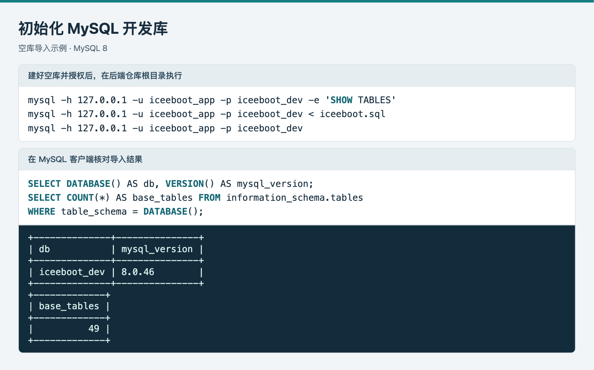
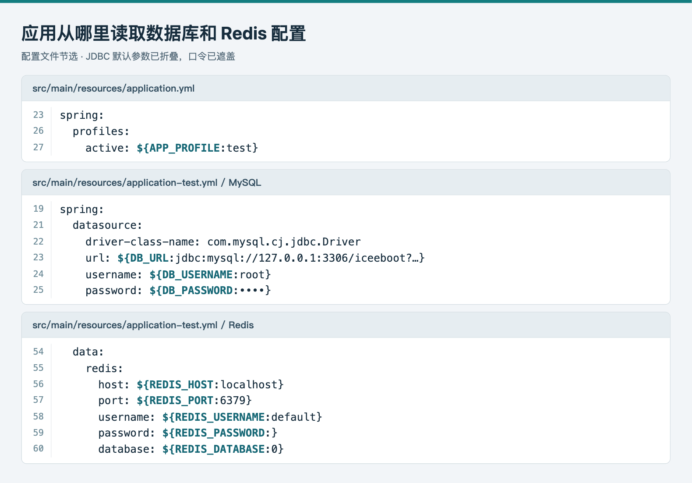
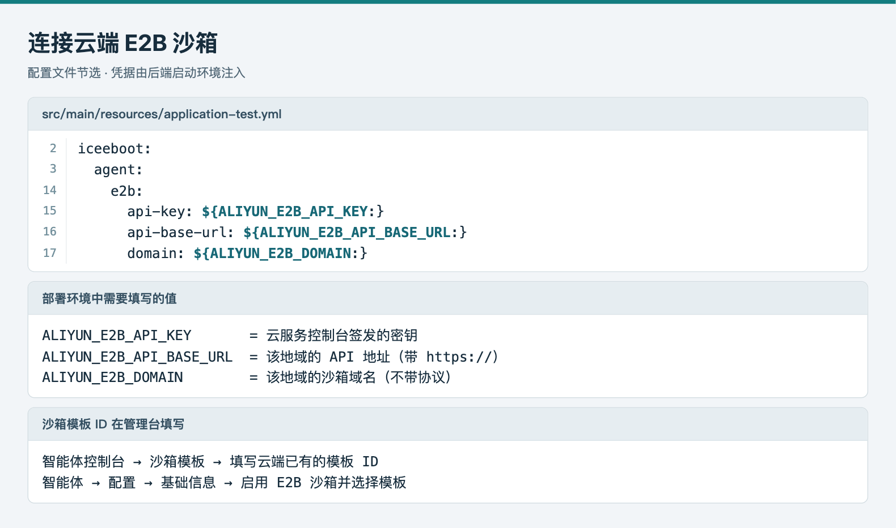
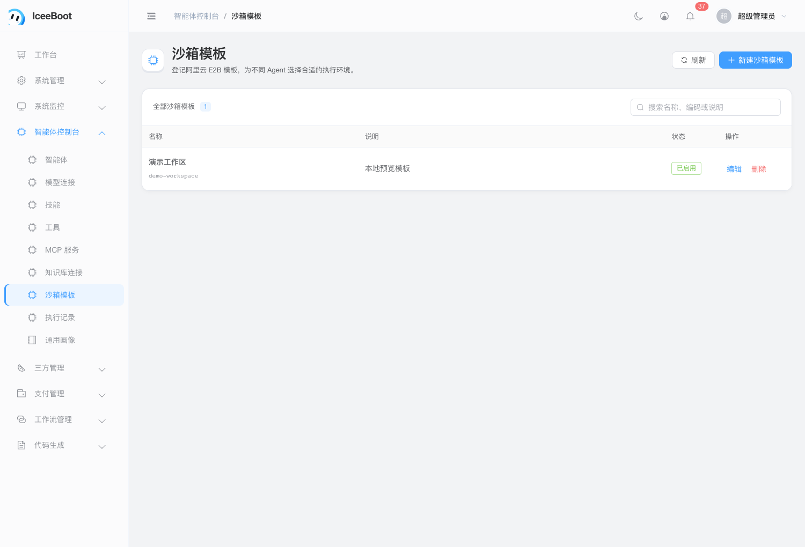
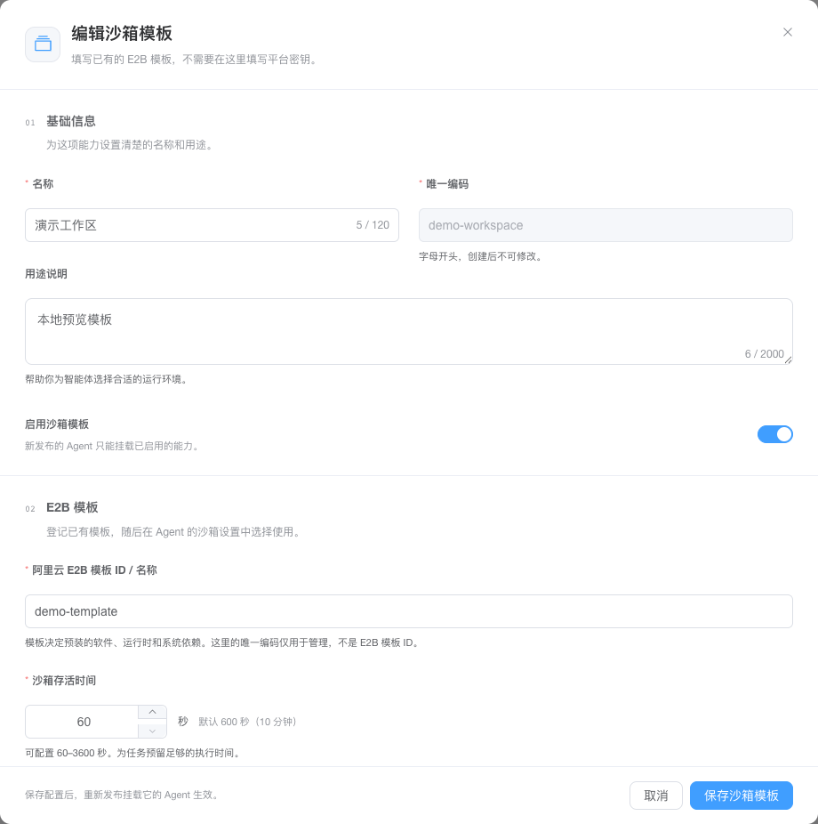
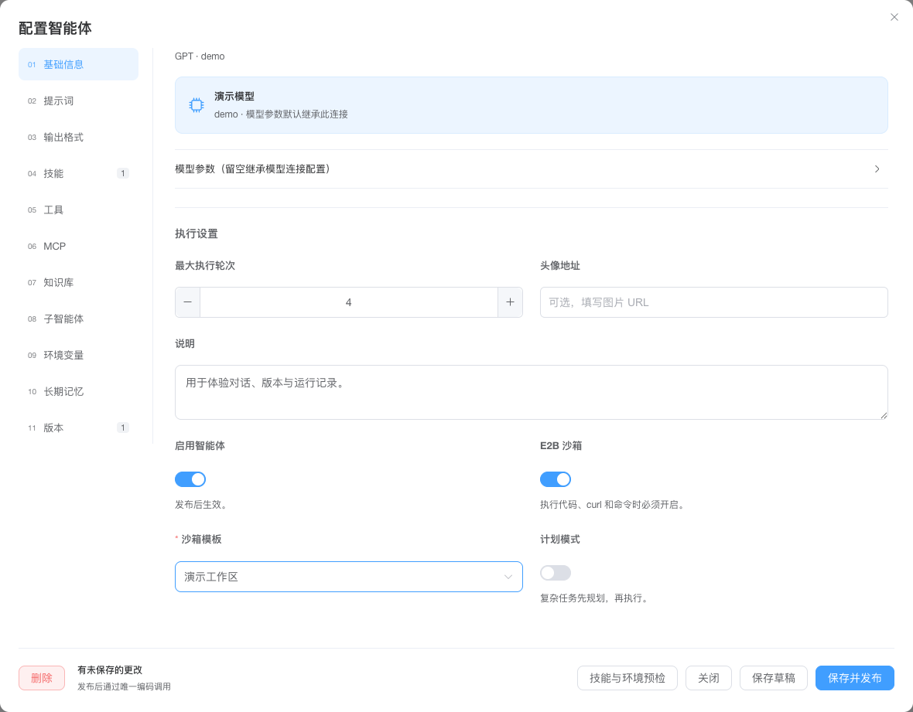
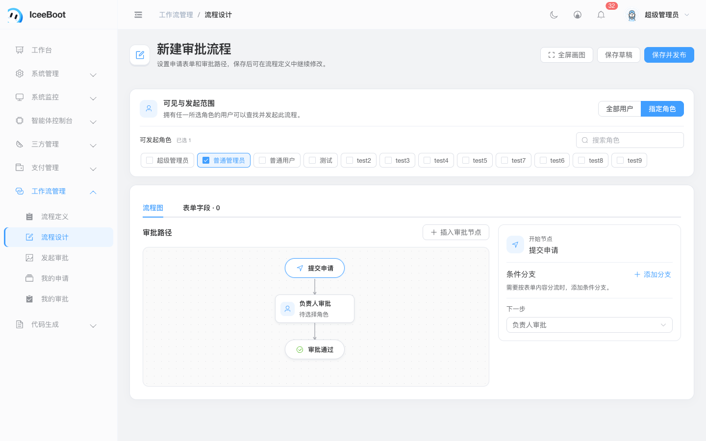

# IceeBoot 后端

**简体中文** | [English](README.en.md)

IceeBoot 是一套 Java 21、Spring Boot 3.5 和 Vue 3 的应用开发框架。后端提供账号、菜单、接口权限、AgentScope 智能体、Activiti 审批、支付和通知。第一次使用，建议先在本机登录管理台，再添加一个业务菜单，最后为需要执行脚本的智能体接入云沙箱。

[初始化数据库](#database-setup) · [启动与登录](#first-login) · [让 AI 配置菜单](#ai-menu) · [接入 E2B 沙箱](#e2b-setup) · [发布和调用智能体](#agent-release) · [开发与排错](#development)

前端管理台可以独立运行 Mock 演示。本文中的管理台截图来自演示环境，配置表单与真实后台使用同一套前端组件。要验证数据库写入、角色授权和云沙箱连通性，请按下文连接自己的 Java 服务。[配套前端指南](https://github.com/perfectNB/IceeBoot-frontend-vue/blob/master/README.md)

<a id="database-setup"></a>
## 1. 准备 MySQL 和 Redis

准备 JDK 21、Maven、MySQL 8、Redis 6.2 或更高版本。示例假设应用与数据库均在本机。在后端仓库根目录操作，先用有建库权限的 MySQL 账号执行：

```sql
CREATE DATABASE iceeboot_dev CHARACTER SET utf8mb4 COLLATE utf8mb4_unicode_ci;
CREATE USER 'iceeboot_app'@'localhost' IDENTIFIED BY '替换为自己的本地数据库密码';
GRANT ALL PRIVILEGES ON iceeboot_dev.* TO 'iceeboot_app'@'localhost';
```

用新账号连接，先确认目标库为空，再从仓库导入基础表、菜单、角色和账号快照。**根目录的 `iceeboot.sql` 含有 `DROP TABLE` 和历史业务数据，只对新建的专用开发库执行。** 已有部署走版本迁移。生产部署请使用团队清理过历史记录并审核过的基础数据。

```bash
mysql -h 127.0.0.1 -u iceeboot_app -p iceeboot_dev -e 'SHOW TABLES'
mysql -h 127.0.0.1 -u iceeboot_app -p iceeboot_dev < iceeboot.sql
mysql -h 127.0.0.1 -u iceeboot_app -p iceeboot_dev -e \
  'SELECT DATABASE(), COUNT(*) AS tables_after_import FROM information_schema.tables WHERE table_schema=DATABASE()'
```

下图是在 MySQL 8.0.46 上导入当前快照的结果：**首次启动服务前共 49 张基础表**。应用启动迁移会继续创建表。



确保 Redis 可以从**运行后端的环境**连接。无密码的本地实例可执行 `redis-cli -h 127.0.0.1 -p 6379 PING`，预期返回 `PONG`。使用密码或 ACL 的实例可用 `redis-cli --user <用户名> --askpass PING`。Docker 中的 `127.0.0.1` 指向当前容器，使用 Compose 时填写实际服务名和容器端口。

<a id="first-login"></a>
## 2. 配好环境，启动并第一次登录

[application.yml](src/main/resources/application.yml) 通过 `APP_PROFILE` 选择 [test](src/main/resources/application-test.yml)、[dev](src/main/resources/application-dev.yml) 或 [prod](src/main/resources/application-prod.yml)，默认使用 `test`。下面的变量放进启动终端，或者放进 IDEA 的运行配置 → **环境变量**。先把示例密码和密钥替换成自己的值。

```bash
export APP_PROFILE=test
export DB_URL='jdbc:mysql://127.0.0.1:3306/iceeboot_dev?allowPublicKeyRetrieval=true&useSSL=false&characterEncoding=UTF-8&serverTimezone=Asia/Shanghai'
export DB_USERNAME='iceeboot_app'
export DB_PASSWORD='<建库时设置的密码>'
export REDIS_HOST='127.0.0.1'
export REDIS_PORT='6379'
export REDIS_USERNAME='default'
export REDIS_PASSWORD=''
export REDIS_DATABASE='0'
export JWT_SECRET_KEY='<独立生成并保存的随机签名密钥>'
export AI_CONFIG_ENCRYPTION_KEY_ID='local-v1'
export AI_CONFIG_ENCRYPTION_KEY='<32 字节随机值的 Base64 编码>'
export YUN_GOU_OS_MCH_ID='local-demo'
export YUN_GOU_OS_KEY='local-demo'
```

- 生成签名密钥和加密密钥时，分别运行一次 `openssl rand -base64 32`，保存各自结果并在后续启动时复用。模型 API Key、工具请求头和智能体沙箱环境变量以加密形式保存。丢失解密密钥会影响已有配置的读取。[密钥轮换说明](docs/agent-maintenance-20261111.md)
- `REDIS_USERNAME`、`REDIS_PASSWORD` 按 Redis 实例填写。示例对应默认账号、无密码的本机开发实例。示例 JDBC 地址中的非 TLS 选项仅用于本机开发。
- `test` 和 `prod` 配置读取 `YUN_GOU_OS_MCH_ID`、`YUN_GOU_OS_KEY`，登录和支付服务启动时会注入它们。上例的占位值仅供本机启动和账号密码登录；联调相关微信或支付渠道时，改用真实的商户配置。生产凭据由部署环境注入。



```bash
java -version
mvn -version
mvn spring-boot:run
```

首次启动会执行已登记的版本脚本、补齐实体表和 RBAC 权限。可在刚才的开发库执行下面的查询，检查最新完成的迁移。项目会校验已应用脚本的摘要，后续升级用新版本脚本。

```sql
SELECT version, description, installed_at
FROM t_agent_schema_history ORDER BY version DESC LIMIT 5;
```

**登录。** 在前端仓库运行 `npm ci`、`npm run dev`，打开 [本地首页](http://localhost:4396)，使用本机开发库中已启用的管理员账号登录。前端变量 `VITE_APP_BASE_API=http://localhost:9000/iceeboot`，实际接口根地址为 `http://localhost:9000/iceeboot/api`。选择账号密码登录时，后端会从 Redis 检查登录限制，从 MySQL 验证身份并返回令牌。

<details>
<summary>刚导入的本地开发库没有已知的管理员密码？</summary>

基础快照中有 `admin` 账号；账号密码由部署方持有，Mock 演示账号的密码不适用于这里的初始化流程。对刚创建的个人开发库，可以在开放服务之前为该账号设一个新密码。后端使用 BCrypt；例如在安装 Apache `htpasswd` 的机器上运行 `htpasswd -nBC 12 admin`，按提示输入自己的密码。复制输出中 `admin:` 之后的完整 BCrypt 哈希。

在刚才新建的库中执行下面的语句，用实际哈希替换占位符：

```sql
USE iceeboot_dev;
SELECT id, username, status FROM t_user WHERE username='admin' AND del_flag=0;
UPDATE t_user SET password='<刚生成的完整 BCrypt 哈希>'
WHERE username='admin' AND del_flag=0 AND status='active';
```

确认更新一行，使用 `admin` 和刚输入的明文密码登录。现有团队环境请由原管理员分配账号。沙箱、模型连接等控制台管理接口还会检查有效的 `superAdmin` 角色。

</details>

<a id="ai-menu"></a>
## 3. 让 AI 添加一个带权限的业务菜单

以在「系统管理」下新增「巡检记录」为例。把前后端两个仓库加入同一个 AI 编程工作区，复制下面这段需求。这个示例要同时交付页面、后端列表接口和数据库迁移，因此在另一套环境部署时，同一份菜单也能随版本到位。

```text
先阅读前后端 AGENTS.md 和相邻系统管理模块，再添加“系统管理 → 巡检记录”。
页面 /admin/system/inspection-records，路由名和组件名 InspectionRecords；
实现前端页面与列表请求、后端 GET /v1/inspections，返回分页数据。
页面查看权限 system:inspection:view，列表接口权限 system:inspection:list:api。
后端按既有包结构分层，Controller 用 @RequirePermission(dynamic = true)；
分页请求用请求对象，响应复用项目 R 和 VO。
用新的可重复执行版本迁移登记菜单、权限、关联和目标角色，并注册迁移。
默认只给 superAdmin；如果需要普通角色，请列出角色编码供我指定。
前端用接口返回的菜单构造路由，复用 src/api 请求封装。同步维护权限目录与相关测试。
给出修改文件、迁移 SQL 和管理员/无权限账号的验收步骤。只在开发库验证。
```

审查 AI 的结果时，对照下面三个地方。截图以框架已有的「用户管理」及其列表权限为参照，「巡检记录」是交给 AI 新增的示例。只是向既有页面开放某个角色时，也可以直接在管理台修改授权。

1. **系统管理 → 菜单管理。** 检查 `t_menu` 的父菜单、唯一名称 `InspectionRecords`、标题「巡检记录」、路径、组件、启用状态及查看权限。前端在 `src/pages/**/*.vue` 中按组件名解析页面。表中的 `component` 应能匹配新增页面文件，省略 `.vue` 后缀。

   

2. **系统管理 → 权限管理。** 菜单或按钮权限控制前端入口。API 权限在 `t_permission` 中用 `type=api`、`method=GET`、`path=/v1/inspections`、`code=system:inspection:list:api` 绑定。路径不含主机、`/iceeboot/api` 或查询参数。写接口另设权限；只给列表权限的角色不能因此修改数据。

   

3. **系统管理 → 角色管理。** 查看角色的菜单授权与权限授权，它们分别对应 `t_role_menu` 和 `t_role_permission`。普通角色需要目标菜单及父级入口，还要有页面和接口所需权限。新增迁移应按角色编码关联，无须写死部署环境中的数字 ID。

   

   

**验收。** 检查新脚本位于 [db/agent](src/main/resources/db/agent)，并已加入 [迁移服务](src/main/java/com/iceeboot/framework/service/database/AgentSchemaMigrationService.java) 的对应清单。新增受保护接口还要更新 [接口权限目录](src/test/resources/rbac/permission-catalog.json)。在开发库启动服务后核对版本记录，重新登录管理员账号，从菜单打开页面并加载数据。再用未授权账号直接请求同一接口，验证业务响应拒绝访问。按钮变灰或菜单隐藏只能验证前端展示。[项目权限约定](docs/framework-permissions-20261111.md)

<a id="e2b-setup"></a>
## 4. 接入云沙箱并登记模板

普通对话或 HTTP 工具可以先跳过此节。执行 Shell、Python 或技能里的脚本时，按「云端模板 → 后端连接 → 控制台登记 → 智能体绑定」的顺序配置。

**在阿里云准备模板。** 使用已有的 E2B 兼容模板，或构建包含所需运行时和依赖的自定义模板，等待云端模板就绪。记下云端返回的模板 ID 或可用于创建沙箱的名称，以及同一地域的 API 入口和沙箱域名。[阿里云 E2B SDK 接入参数](https://help.aliyun.com/zh/functioncompute/e2b-sdk-integration-parameter-description) · [构建自定义镜像模板](https://help.aliyun.com/zh/functioncompute/build-a-custom-image-template)

**给 Java 服务配置连接。** 在运行后端的同一环境中追加：

```bash
export ALIYUN_E2B_API_KEY='<本地域沙箱平台的 API Key>'
export ALIYUN_E2B_API_BASE_URL='<云端 API 入口，含 https://>'
export ALIYUN_E2B_DOMAIN='<沙箱域名，不含 https:// 或路径>'
```

阿里云接入示例中的 `E2B_API_URL` 对应本项目的 `ALIYUN_E2B_API_BASE_URL`。三个变量在 `iceeboot.agent.e2b` 下绑定。保存后**重启后端**，让进程读取最新环境。



**在控制台登记云端模板。** 用超级管理员打开「智能体控制台 → 沙箱模板」，点击新增。这里保存的是可供智能体选择的配置记录；镜像的构建和发布在云端完成。



| 表单字段 | 填写示例或要求 |
| --- | --- |
| 名称 / 唯一编码 | 如「Python 分析环境」和 `python_workspace`，供 IceeBoot 管理台查找与区分资源。 |
| 阿里云 E2B 模板 ID / 名称 | 填上一步得到的**云端模板 ID 或名称**。与表单里的本地唯一编码是两个不同的字段。 |
| 沙箱存活时间 | 单位秒，可选 60～3600，界面默认 600。按任务所需时间选择。 |
| 启用 | 启用后保存，回到智能体配置时才能在模板列表中选择。 |



<a id="agent-release"></a>
## 5. 把沙箱绑定到智能体，发布并调用

1. 在「智能体控制台 → 模型连接」新建并启用连接。填写供应商、支持的协议、模型标识、服务商的 Base URL 和 API Key。后端用第 2 步的加密密钥存储敏感配置。

   

2. 进入「智能体」，新建或配置一个智能体。填写名称、唯一编码、提示词并选择运行模型。示例使用编码 `assistant`。需要运行脚本时，在「基础信息」开启 **E2B 沙箱**，选中登记的模板；在「技能」或「工具」挂载所需能力。脚本用到的变量放在该智能体的「环境变量」分区。

   

3. 点击「保存草稿」，再点「技能与环境预检」。预检读取最近保存的草稿，会创建并释放一个真实云沙箱，检查工作目录和可识别的依赖。预检可能产生云资源费用；缺包时调整云端模板，重新登记或绑定后再检查。业务脚本和模型调用在实际运行时验证。

   下图为 Mock 演示，只显示模型连接检查通过。实际沙箱启动、工作目录与依赖的结果以连接后端后的预检报告为准。

   

4. 点击「保存并发布」。发布版本固定当时的模型和资源配置。修改模板或模型后，需要为使用它的智能体重新发布。用「开始对话」发送一条简单请求，在「执行记录」里核对结果和运行 ID。


业务系统可使用当前有权限的 `superAdmin` 账号的访问令牌，按**已发布智能体编码**调用。把 `ACCESS_TOKEN` 放入调用进程环境，替换 URL 中的 `assistant`：

```bash
curl -sS -X POST 'http://localhost:9000/iceeboot/api/v1/agent-console/agents/by-code/assistant/invoke' \
  -H "Authorization: Bearer ${ACCESS_TOKEN}" \
  -H 'Content-Type: application/json' \
  -d '{"input":"请用一句话介绍你的职责"}'
```

成功时，HTTP JSON 响应的 `code` 为 200，`result.output` 是回答，`result.runId` 可用于对照执行记录。测试脚本执行时，换成需要调用已挂载脚本的任务，并从该次运行记录检查具体工具步骤。[会话与附件](docs/agent-workbench.md) · [流式调用](docs/agent-streaming.md) · [定时任务](docs/agent-schedules.md) · [长期记忆](docs/agent-memory.md)

<a id="development"></a>
## 继续开发与排错

| 要扩展的功能 | 从这里开始 |
| --- | --- |
| 管理 API、数据对象与事务 | [Controller](src/main/java/com/iceeboot/framework/controller)、[Service](src/main/java/com/iceeboot/framework/service)、[DO](src/main/java/com/iceeboot/framework/entity)、[Mapper](src/main/java/com/iceeboot/framework/mapper)。输入使用 DTO 或查询对象，输出使用 VO。[开发约定](AGENTS.md) |
| 模型、Skill、Tool、MCP、知识库与沙箱 | [智能体服务](src/main/java/com/iceeboot/framework/service/agent)、[Agent 配置](src/main/java/com/iceeboot/config/agent)、[Skill 导入](docs/skill-import.md) |
| 流程与审批 | [工作流服务](src/main/java/com/iceeboot/framework/service/workflow) 处理模板、版本、角色范围、金额条件、会签与审批轨迹。 |
| 支付、任务与代码生成 | [支付渠道说明](docs/payment-channels.md)、[代码生成模块](src/main/java/com/iceeboot/generator) |
| 运行测试或打包 | 在仓库根目录运行 `sh scripts/verify.sh`，执行代码约定检查及 Maven `clean verify`。在同一套环境变量下用 `java -jar target/iceeboot-backend-java-1.0.0.jar` 运行产物。 |



| 现象 | 优先检查 |
| --- | --- |
| 启动时报数据库连接或迁移错误 | 在与后端相同的环境用应用账号连接目标库，核对 profile、库名、权限、迁移版本和日志。已有环境升级前备份库及加密密钥。 |
| 页面能打开，登录时提示 Redis 连接失败 | 用后端配置里的 Redis 主机、端口、账号及密码测试 `PING`；确认容器端口映射与后端的运行位置一致。 |
| 菜单出现但页面打不开，或列表、按钮返回拒绝访问 | 分别核对组件名、当前角色的菜单范围、按钮权限、接口 HTTP 方法和路径。涉及资源归属或 `superAdmin` 的接口还要满足业务角色检查。 |
| 模板已保存但预检失败 | 核对后端进程是否读到了三项 E2B 变量，云端模板是否就绪、地域是否一致、依赖是否预装，查看预检报告中的失败项。 |
| 需要查接口参数 | [本机 Swagger UI](http://localhost:9000/iceeboot/api/swagger-ui/index.html) 和 [OpenAPI JSON](http://localhost:9000/iceeboot/api/v3/api-docs)；如定义请求出现业务错误，可按响应中的 traceId 查服务日志，并与 Controller 的路径及 DTO 对照。 |

[许可证](LICENSE)
