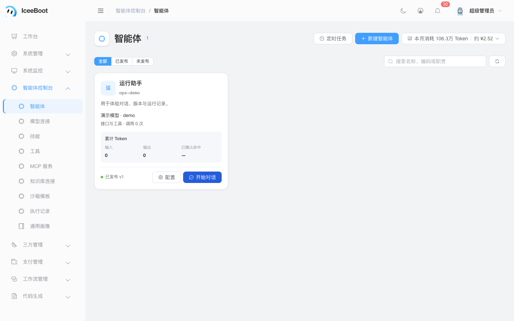

# IceeBoot 后端

IceeBoot 是用 Java 21 和 Spring Boot 3.5 构建的应用服务。它给管理台提供用户权限、智能体、审批流程、支付及通知接口，也允许其他业务系统通过 HTTP 调用已发布的智能体。

## 服务能做什么

| 模块 | 一次典型操作 |
| --- | --- |
| 用户、角色与权限 | 用户登录后获取菜单，后端根据当前身份、角色和接口权限校验请求。系统管理还提供用户维护、日志、消息和工作台统计。 |
| AgentScope 智能体 | 创建模型连接，给智能体配置提示词、Skill、Tool、MCP、知识库连接与子智能体。发布后按唯一 code 调用，或在会话中流式交互，查看执行事件、附件和模型用量。 |
| Activiti 审批 | 保存草稿、发布版本、配置发起角色、金额分支及并行会签。每轮审批绑定发起时的版本；停用模板会阻止新申请。在途申请继续办理，驳回后重新发起可追溯历轮记录。 |
| 文件、短信与邮件 | 管理渠道配置，通过服务层执行上传或发送。具体能力取决于启用的供应商和有效凭据。 |
| 支付 | 配置支付渠道，维护订单、处理回调并查询支付记录。业务接入和渠道配置见[支付说明](docs/payment-channels.md)。 |
| 任务与代码生成 | 用 Quartz 调度任务，从表结构生成业务代码；管理台提供相应的配置和预览入口。 |

下面是前端 Mock 演示环境中的管理界面，分别对应后端的智能体配置服务和审批服务。




## 架构与代码位置

服务以一个可执行 JAR 交付。Controller 接收请求，权限检查与业务服务处理操作，数据库保存业务状态和审计记录。模型调用、沙箱和第三方渠道通过各自的适配层接入。

```text
Vue 管理台 / 业务调用方
       │ HTTP JSON 或 SSE
       ▼
Controller ── 登录态、角色与接口权限
       │
       ├── 系统与业务 Service ── MyBatis-Plus / JDBC ── MySQL
       ├── 智能体 Service ── AgentScope Harness ── 模型 / 工具 / 可选 E2B
       └── 审批 Service ── Activiti ── 已发布流程、运行任务与审批记录
```

| 目录 | 职责 |
| --- | --- |
| [framework/controller](src/main/java/com/iceeboot/framework/controller) | 系统、Agent、工作流和第三方模块的 HTTP 入口。 |
| [framework/service](src/main/java/com/iceeboot/framework/service) | 业务事务与状态变化。`agent` 包管理智能体配置、发布、会话和运行；`workflow` 包处理设计、发起、会签和历史详情。 |
| [framework/entity](src/main/java/com/iceeboot/framework/entity) · [mapper](src/main/java/com/iceeboot/framework/mapper) · [resources/mapper](src/main/resources/mapper) | 数据对象、映射接口与 SQL。`framework/dto` 和 `framework/vo` 定义输入及输出。 |
| [common](src/main/java/com/iceeboot/common) · [config](src/main/java/com/iceeboot/config) | 统一响应和异常处理、登录工具，以及 MVC、Redis、工作流引擎等基础配置。 |
| [db/agent](src/main/resources/db/agent) · [service/database](src/main/java/com/iceeboot/framework/service/database) | 启动初始化、带版本的表结构及权限迁移。 |
| [generator](src/main/java/com/iceeboot/generator) · [resources/templates](src/main/resources/templates) | 代码生成与模板。 |

MySQL 保存业务记录、发布快照和运行历史；Redis 参与登录态及权限缓存。智能体的输入输出受会话和用户范围约束，模型连接使用后端管理的密钥。工作流的模板可见范围与节点办理角色可分别配置，查询详情和提交审批都会检查当前用户的权限。

## 本地启动

准备 JDK 21、Maven、MySQL 8 和 Redis 6.2 或以上。以下示例用于首次搭建本地开发环境。

**1. 准备数据库。** 创建专用空库。仓库根目录的 SQL 快照包含基础表和菜单等初始数据，也包含 `DROP TABLE`；仅在新建的空库导入。已有环境升级前先备份，按迁移历史检查差异。

```bash
mysql -u root -p -e 'CREATE DATABASE iceeboot_dev CHARACTER SET utf8mb4 COLLATE utf8mb4_unicode_ci'
mysql -u root -p iceeboot_dev < iceeboot.sql
```

**2. 配置连接和密钥。** 将下列配置注入启动服务的进程。示例假定已为该库创建应用账号。应用启动时会检查并补充表结构及菜单权限，账号须具有相应权限。

```bash
export APP_PROFILE=test
export DB_URL='jdbc:mysql://127.0.0.1:3306/iceeboot_dev?useUnicode=true&characterEncoding=UTF-8&serverTimezone=Asia/Shanghai'
export DB_USERNAME='iceeboot'
export DB_PASSWORD='<本地数据库密码>'
export REDIS_HOST='127.0.0.1'
export REDIS_PORT='6379'
export REDIS_PASSWORD='<本地 Redis 密码>'
export REDIS_DATABASE='0'
export JWT_SECRET_KEY='<稳定保存的随机签名密钥>'
export AI_CONFIG_ENCRYPTION_KEY_ID='local-v1'
export AI_CONFIG_ENCRYPTION_KEY='<32 字节随机密钥的 Base64 编码>'
```

可用 `openssl rand -base64 32` 生成一个密钥，每项安全用途使用独立值。保存模型凭据后，后续启动须能读取原加密密钥。Redis 没有启用密码时，将 `REDIS_PASSWORD` 设为空；使用 ACL 时同时配置 `REDIS_USERNAME`。按需配置模型和外部服务，运行沙箱任务还需可用的 E2B 模板和凭据。

**3. 启动并查看接口。**

```bash
mvn spring-boot:run
```

默认端口为 `9000`，应用上下文为 `/iceeboot/api`。可以在 [本机 Swagger UI](http://localhost:9000/iceeboot/api/swagger-ui/index.html) 浏览接口，在 [OpenAPI JSON](http://localhost:9000/iceeboot/api/v3/api-docs) 查看机器可读定义。管理台开发环境将 `VITE_APP_BASE_API` 指向 `http://localhost:9000/iceeboot`。

本次本地验证中，Swagger UI 页面与分组配置可以打开，但 OpenAPI 定义请求返回业务错误码 500，页面未能列出接口。遇到相同情况，可在服务日志中按响应里的 `traceId` 查找异常，也可直接查看上表的 Controller 目录核对路径、参数与权限。

## 典型的接口调用

管理台和业务客户端共用服务端的权限校验。从有调用权限的账号取得访问令牌，在智能体控制台配置模型并发布智能体后，将下面的 `assistant` 替换为实际的智能体 code。

```bash
curl -X POST 'http://localhost:9000/iceeboot/api/v1/agent-console/agents/by-code/assistant/invoke' \
  -H "Authorization: Bearer ${ACCESS_TOKEN}" \
  -H 'Content-Type: application/json' \
  -d '{"input":"请总结本周工作"}'
```

审批客户端通过 `/v1/workflow/approvals` 下的接口读取模板、发起申请、获取待办和处理审批。个人列表可传 `scope`、`page`、`size`、流程名称 `keyword` 和审批状态 `status`，由后端在用户可见范围内筛选后分页。示例：`GET /iceeboot/api/v1/workflow/approvals/cases?scope=mine&page=1&size=10&status=PENDING`。

## 测试、打包与排查

```bash
sh scripts/verify.sh
java -jar target/iceeboot-backend-java-1.0.0.jar
```

验证脚本先检查项目约定，再执行 Maven `clean verify`，完成编译、测试和打包。工作流回归使用 H2 与 Activiti，部分接口测试需要监听本机临时端口。默认测试以本地替身验证外部服务调用；实际模型与支付渠道须用对应测试环境单独联调。

- **数据库启动错误**：核对生效的 profile、JDBC 地址、账号权限及日志中的迁移版本。版本脚本和校验记录都参与后续升级。
- **登录成功但操作返回权限错误**：核对角色关联的菜单和接口权限。审批还要检查模板发起范围或当前节点角色。角色变更后刷新登录信息。
- **智能体无法执行**：检查模型连接、当前发布版本、挂载能力及沙箱配置，再按运行记录定位具体阶段。

[前端项目与 Mock 快速开始](https://gitee.com/woshinibaba438cnmlgb/zboot-frontend-vue/blob/20261110-agentscope-harness/README.md) · [智能体工作台](docs/agent-workbench.md) · [会话](docs/agent-conversations.md) · [流式事件](docs/agent-streaming.md) · [定时执行](docs/agent-schedules.md) · [Skill 导入](docs/skill-import.md) · [许可证](LICENSE)
